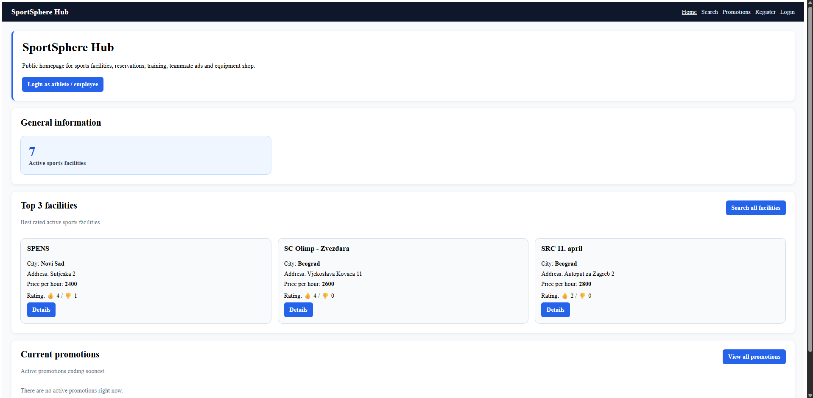
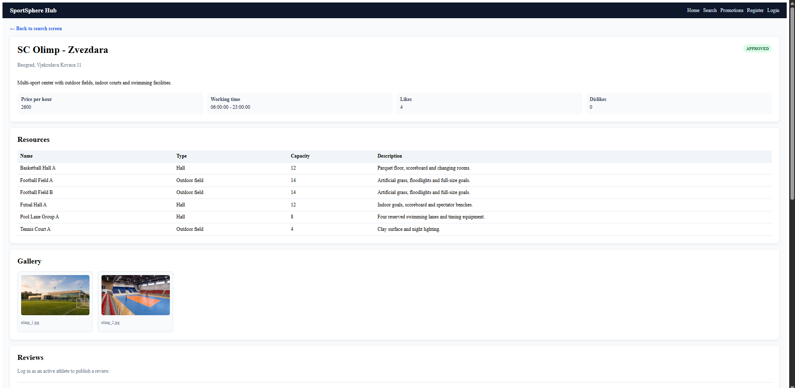
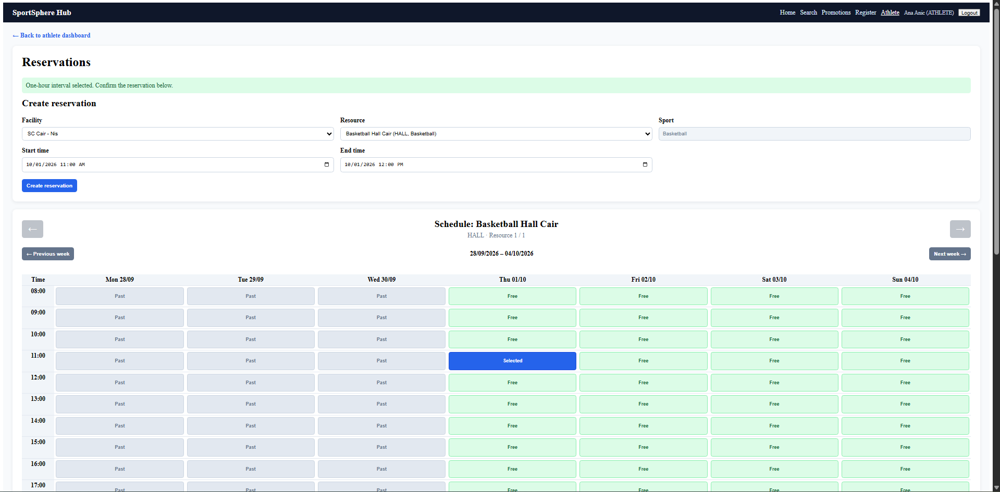
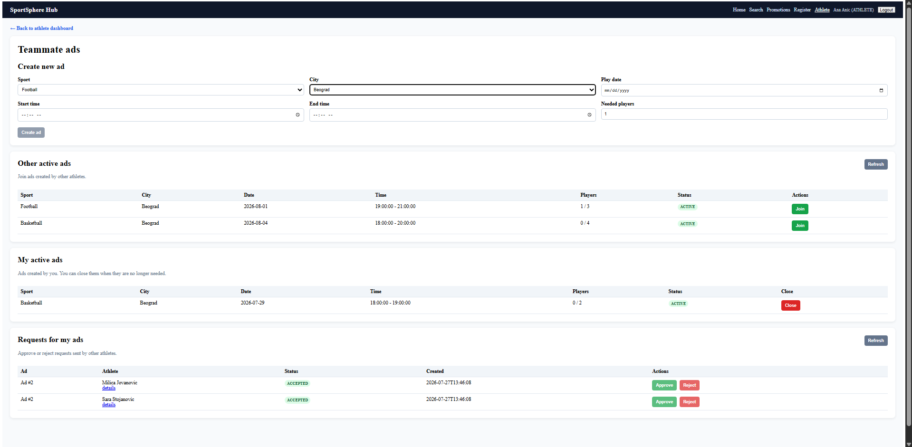
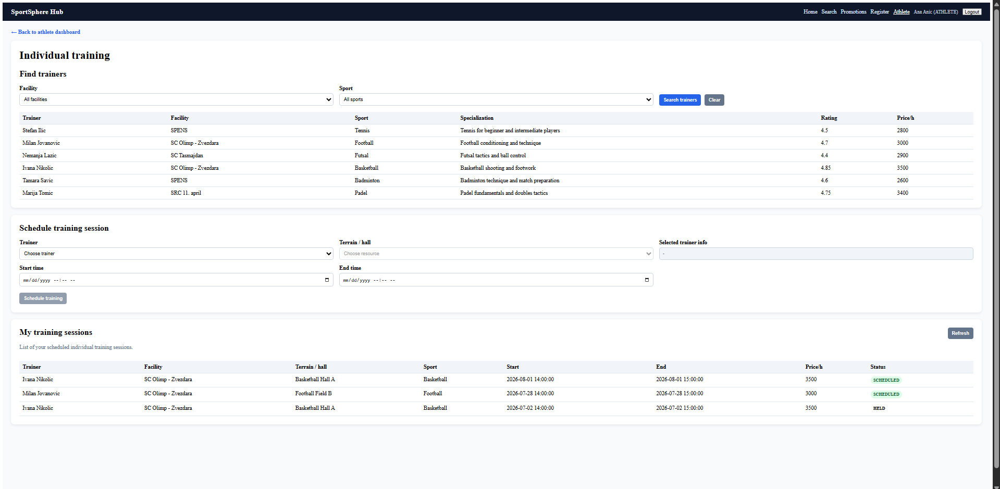
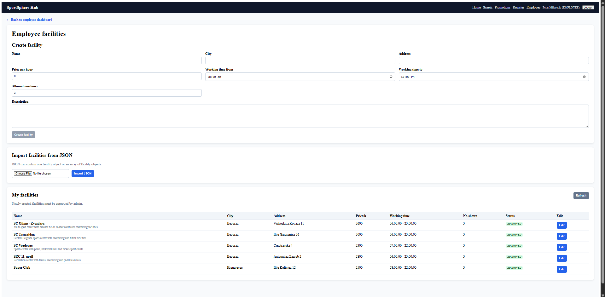
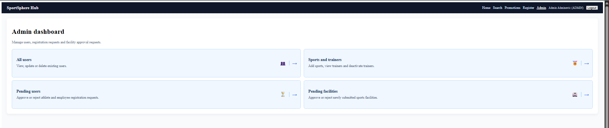

# Sportsphere

**Sportsphere** is a full-stack sports facility and activity management platform built with **Angular, Spring Boot, and MySQL**.

The application supports several user roles and combines facility discovery and reservation management with training sessions, teammate matching, equipment management, promotions, reporting, and administrative workflows.

## Features

### Athletes
- Create and manage a personal profile
- Select favorite sports
- Search available sports facilities
- View detailed facility information, resources, images, reviews, and location
- Create and manage facility reservations
- Browse weekly resource availability and select reservation time slots
- Search for teammates through teammate advertisements
- Create teammate advertisements and respond to existing ones
- Browse available trainers
- Schedule and manage individual training sessions

### Employees
- Manage employee profiles
- Create, update, and manage sports facilities
- Manage facility resources and information
- Import facility data from JSON
- Review and confirm reservations
- Mark reservation no-shows
- Manage equipment
- Create and manage promotions
- Generate PDF reports

### Administrators
- Review pending user registrations
- Review pending sports facilities
- Manage registered users
- Manage sports and trainers
- Approve or reject administrative requests

## Additional Functionality

- Role-based application workflows
- Authentication and user management
- Facility search and filtering
- Facility reviews and ratings
- Facility image galleries and map/location display
- Reservation conflict handling
- Training management
- Teammate matching
- Equipment management
- Promotions
- PDF report generation
- Application statistics and reporting
- Input validation and state-based workflow handling

## Tech Stack

### Frontend
- Angular
- TypeScript
- HTML
- CSS
- RxJS

### Backend
- Java
- Spring Boot
- Spring Web / REST
- Spring Data JPA
- Hibernate
- Maven

### Database
- MySQL

### Additional Libraries and Tools
- Chart.js
- OpenPDF
- Jackson
- Git

## Architecture

Sportsphere follows a conventional multi-layer web application architecture:

```text
Angular SPA
    │
    │ HTTP / REST
    ▼
Spring Boot Controllers
    │
    ▼
Service Layer
    │
    ▼
Spring Data JPA Repositories
    │
    ▼
MySQL Database
```

The frontend communicates with the backend through REST APIs. The backend separates HTTP handling, business logic, persistence, and database access into dedicated layers.

## Project Structure

```text
sportsphere/
│
├── frontend/              # Angular frontend
│   ├── src/
│   ├── angular.json
│   ├── package.json
│   └── ...
│
├── backend/               # Spring Boot backend
│   ├── src/
│   ├── pom.xml
│   ├── mvnw
│   └── ...
│
├── docs/
│   └── screenshots/       # README screenshots
│
├── .gitignore
└── README.md
```

Generated dependencies and build artifacts such as `node_modules`, Angular build output, Maven `target` directories, IDE configuration, and local environment files are intentionally excluded from the repository.

## Screenshots

### Home

The public homepage provides an overview of active sports facilities, highly rated facilities, current promotions, and access to facility discovery.



### Facility Details

Each facility has a detailed public page containing its resources, pricing, working hours, ratings, descriptions, and image gallery.



### Reservation System

Athletes can inspect resource availability through a weekly schedule and select available time slots directly from the calendar. The application distinguishes past, available, occupied, and currently selected time slots.



### Teammate Matching

Athletes can create advertisements for upcoming games, join advertisements created by other athletes, manage their own advertisements, and approve or reject participation requests.



### Individual Training

Athletes can search trainers by facility and sport, compare specialization, rating, and hourly price, schedule individual training sessions, and review their existing sessions.



### Employee Facility Management

Employees can create and edit facilities, import facility data from JSON, manage their associated facilities, and follow their approval status.



### Administration

Administrators have dedicated workflows for managing users, registration requests, sports and trainers, and newly submitted facilities.



## Running the Project Locally

### Prerequisites

Make sure the following are installed:

- Java / JDK
- Maven, or use the included Maven Wrapper
- Node.js and npm
- Angular CLI
- MySQL

### 1. Database

Create a MySQL database for Sportsphere and configure the datasource settings used by the backend.

Example configuration:

```properties
spring.datasource.url=jdbc:mysql://localhost:3306/sportsphere
spring.datasource.username=YOUR_USERNAME
spring.datasource.password=YOUR_PASSWORD
```

Do not commit real database credentials or other secrets to the repository.

### 2. Backend

Navigate to the backend directory:

```bash
cd backend
```

On Windows:

```bash
mvnw.cmd spring-boot:run
```

On Linux/macOS:

```bash
./mvnw spring-boot:run
```

Alternatively, the project can be started from an IDE as a Spring Boot application.

By default, the backend runs at:

```text
http://localhost:8080
```

### 3. Frontend

Navigate to the frontend directory:

```bash
cd frontend
```

Install dependencies:

```bash
npm install
```

Start the Angular development server using the project proxy configuration:

```bash
npx ng serve --proxy-config proxy.conf.json
```

The frontend will normally be available at:

```text
http://localhost:4200
```

The proxy forwards frontend requests beginning with `/api` to the Spring Boot backend running on port `8080`.

## Main Application Domains

The backend is organized around several major areas of functionality:

```text
Authentication
Users and Profiles
Sports
Facilities and Resources
Reservations
Organizations and Employees
Teammate Advertisements
Trainers and Training Sessions
Equipment
Promotions
Reports
```

This separation is reflected throughout the REST API, service layer, persistence layer, and Angular application.

## About the Project

Sportsphere was developed as a full-stack university software engineering project at the **University of Belgrade – School of Electrical Engineering (ETF)**.

The project provided hands-on experience with designing and implementing a complete web application, including frontend development, REST API design, backend business logic, relational database persistence, authentication, role-dependent workflows, validation, reporting, and integration between all application layers.

## Author

**Nemanja Nikolić**

- GitHub: [NemanjaNikolic19](https://github.com/NemanjaNikolic19)
- LinkedIn: [nemanjanikolic19](https://www.linkedin.com/in/nemanjanikolic19)
